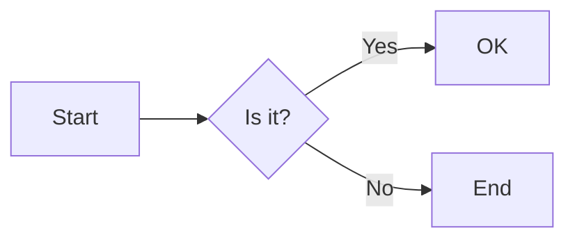
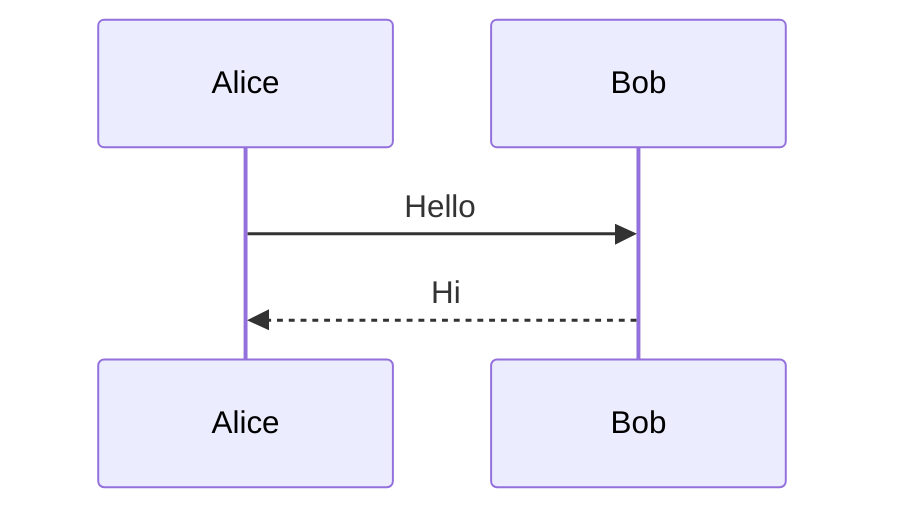
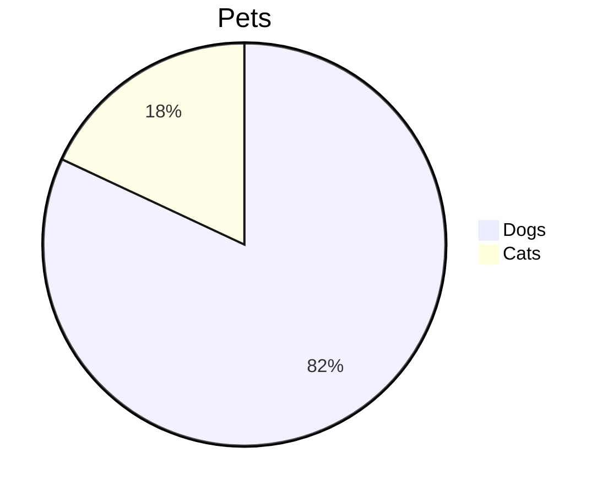
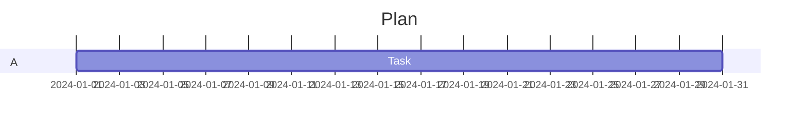
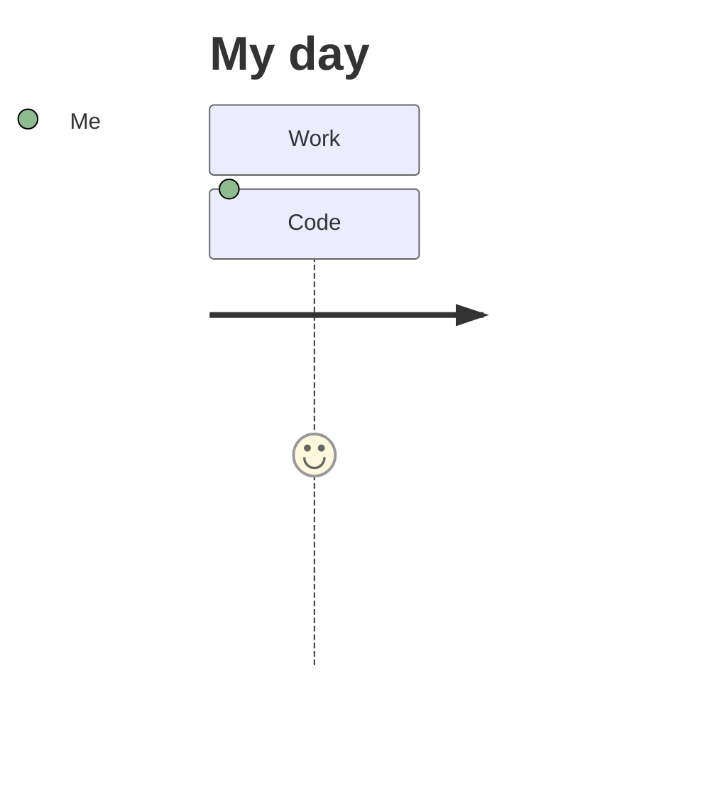
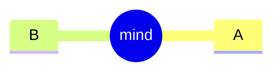
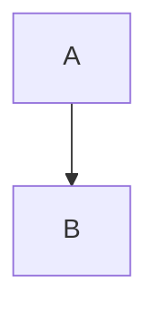

# Extras

## X01 Inkdrop-only languages

```elixir
defmodule Greeter do
  @moduledoc "Says hi"
  def hello(name) when is_binary(name), do: "Hello, #{name}!" # c
  def sum(list), do: Enum.reduce(list, 0, fn x, acc -> x + acc end)
end
```

```ex
IO.puts(:atom)
```

```graphql
query Hero($id: ID!) {
  hero(id: $id) { name friends { name } } # c
}
type Droid implements Character { id: ID! primaryFunction: String }
```

```svelte
<script>
  let count = 0;
  const double = () => count * 2; // c
</script>
<button on:click={() => count += 1}>{count} {double()}</button>
<style>button { color: red; }</style>
```

```nix
{ pkgs ? import <nixpkgs> {} }:
let x = 1; in pkgs.mkShell { buildInputs = [ pkgs.git ]; name = "n${toString x}"; } # c
```

```julia
function f(x::Int)
    return x + 1 # c
end
```

## X02 Mermaid













```mermaid
requirementDiagram
  requirement r1 { id: 1 }
```



## X03 multi-line fences in a quote and in lists

> ```python
> def f(x):
>     return x + 1  # c
> ```

> ```js
> const a = 1; // c
> function g() { return `t ${a}`; }
> ```

- item
  ```sh
  echo "$HOME" | grep x # c
  ls -la
  ```

1. numbered
   ```js
   const b = 2; // c
   const c = [1, 2];
   ```

- outer
  > ```python
  > x = 1  # c
  > y = "s"
  > ```

## X04 Markdown inside Markdown

````markdown
---
title: nested front matter
tags: [x, y]
---

# Heading 1

## Heading 2 with `code` and **bold** and *em* and ~~strike~~

Setext heading
==============

- list item
  - nested item
1. ordered
2. second

- [ ] todo
- [x] done

> quote with **bold**
> second line

> [!NOTE]
> A note.

> [!TIP]
> A tip.

> [!IMPORTANT]
> Important.

> [!WARNING]
> Warning.

> [!CAUTION]
> Caution.

> [!UNKNOWN]
> Not an alert.

| a | b |
|---|---|
| 1 | 2 |

https://example.com/path?q=1 and www.example.com and example.com/page and mailto:a@b.co and ftp://f.example/x and inkdrop://note/1 end

<https://auto.example.com> and [link](https://x.example.com "t") and  and [ref][1]

[1]: https://ref.example.com

Inline math $x^2 + \alpha$ and price $5 and $6 and $$a+b$$ inline double

$$
\frac{a}{b} + \sum_{i=1}^{n} x_i % comment
$$

$$ trailing
\int_0^1 x\,dx
$$

---

Hard break with two spaces  
next line and a footnote[^1]

[^1]: the note

```js
const nested = 1; // fenced js inside
```

~~~python
print("tilde")
~~~

    indented code

<div>html block</div>

Text with <span>inline html</span> and `` code `` and \*escaped\*.
````

## X05 top-level math

$$
\begin{aligned} a &= b \\ c &= \frac{d}{e} \end{aligned} % c
$$

Text between.

$$
x = \sqrt{y}
