# Mermaid (Pele)

## Flowchart

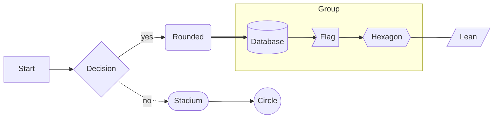

## Flowchart with user styles

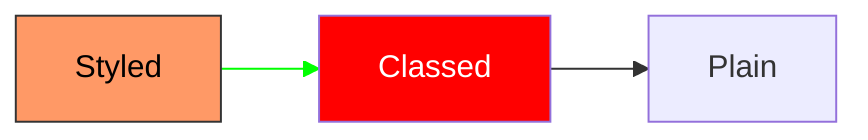

## Flowchart with SVG text labels

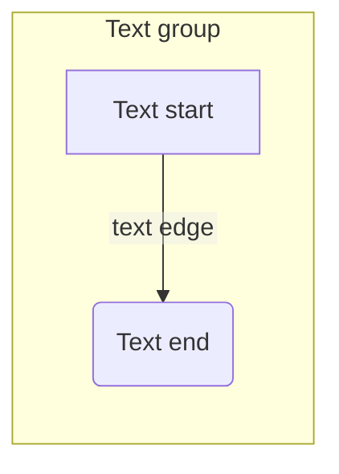

## Sequence

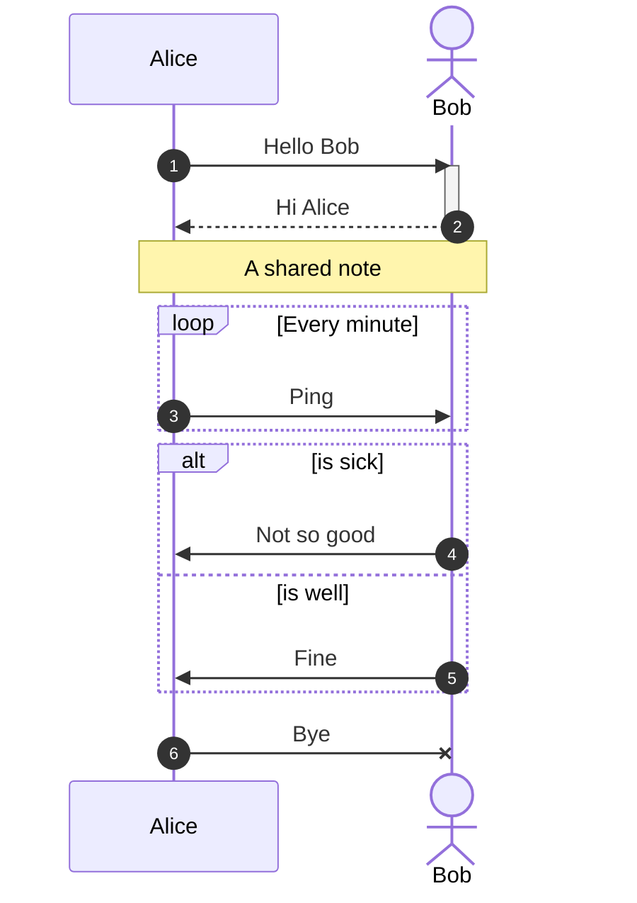

## Class

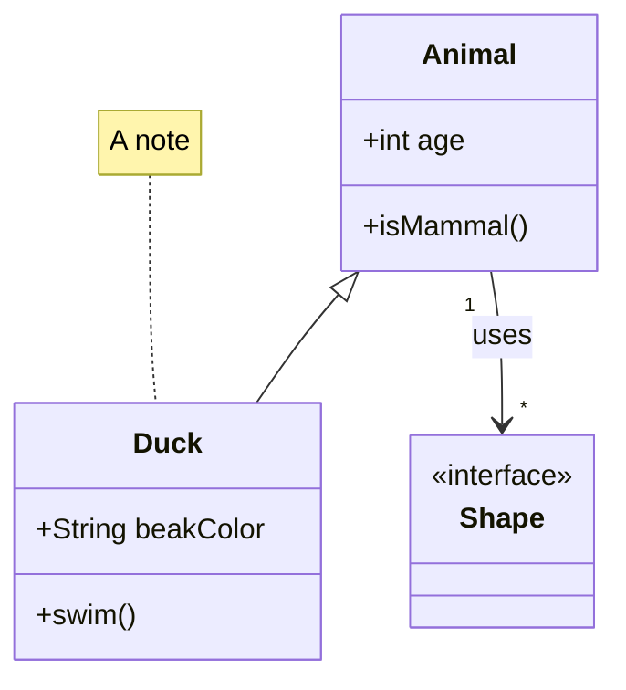

## State

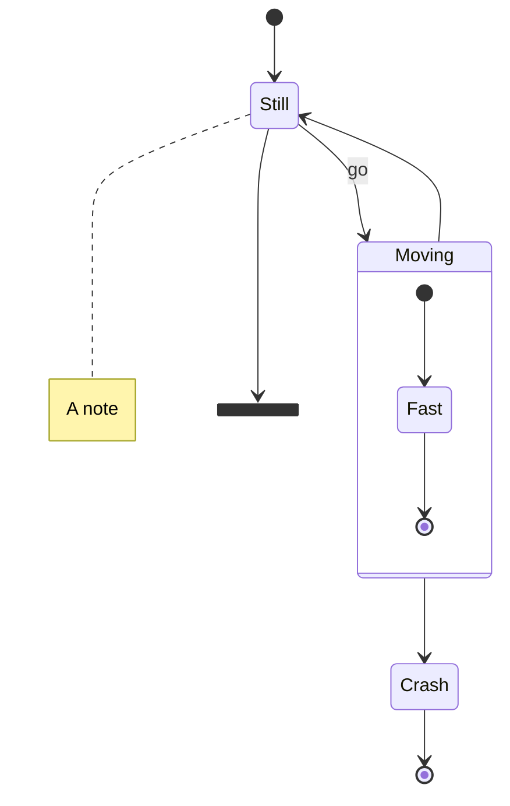

## Entity relationship

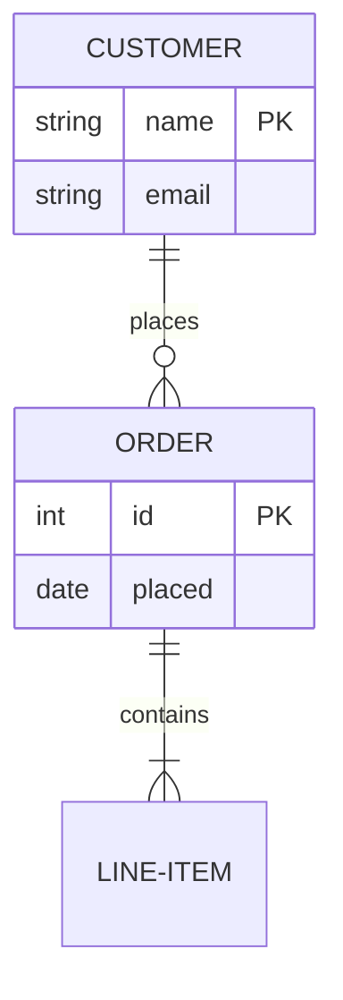

## Gantt

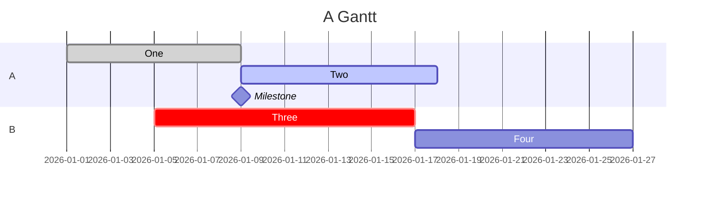

## Pie

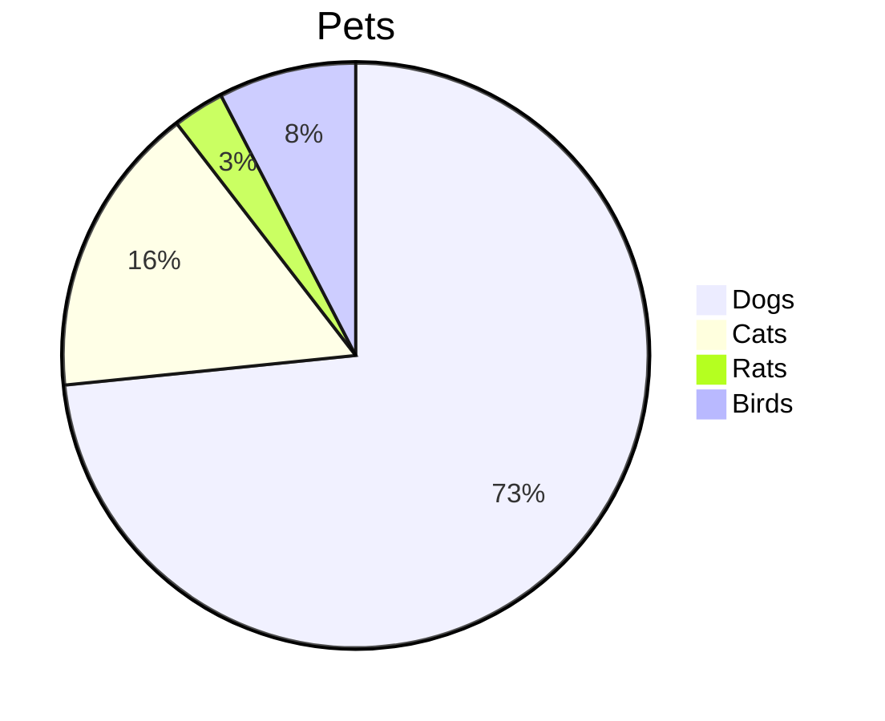

## User journey

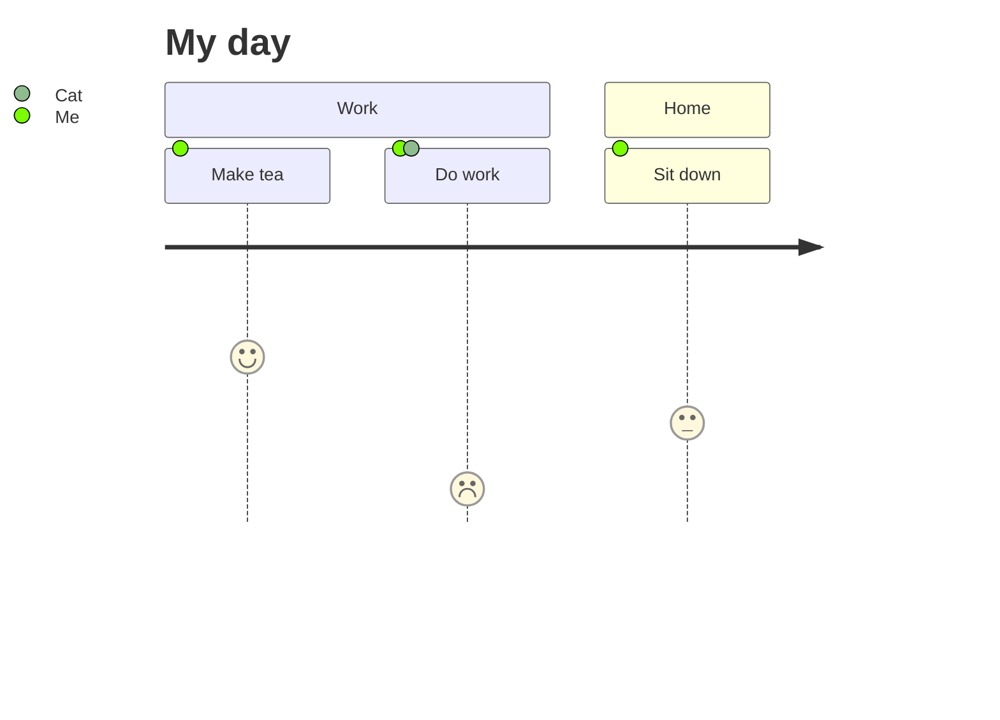

## Git graph

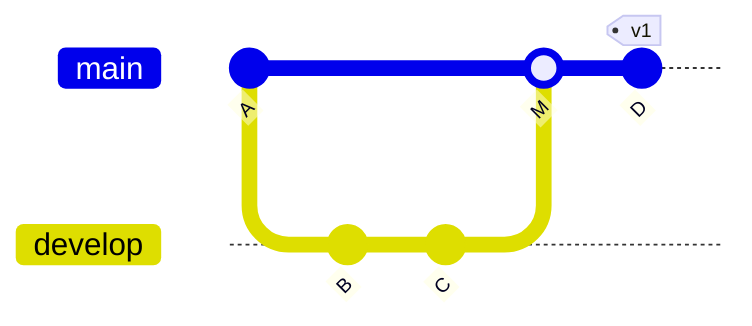

## Mindmap

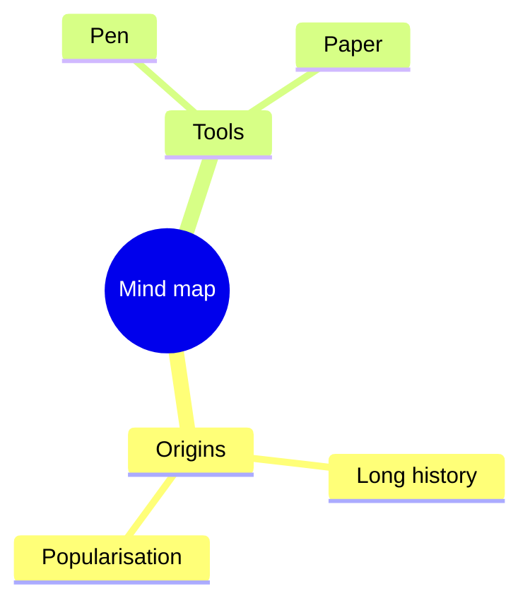

## Timeline

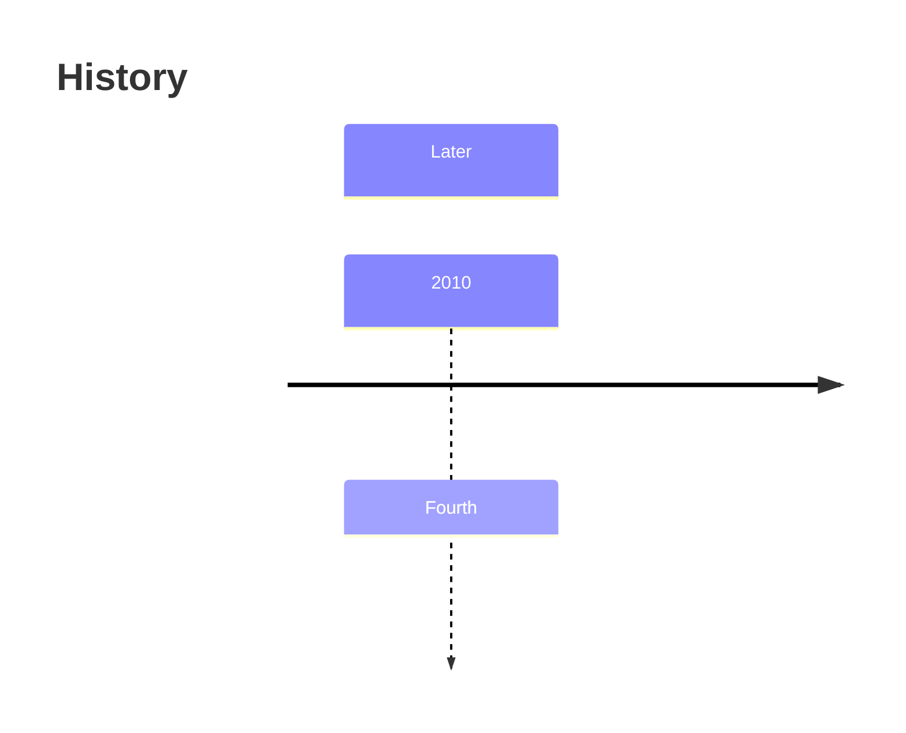

## Quadrant chart

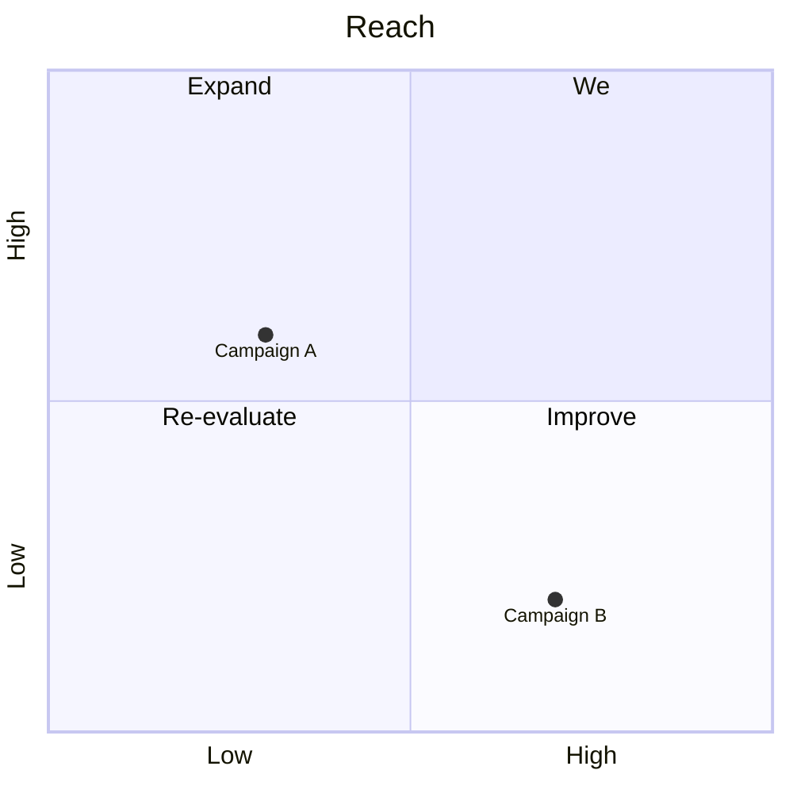

## Requirement

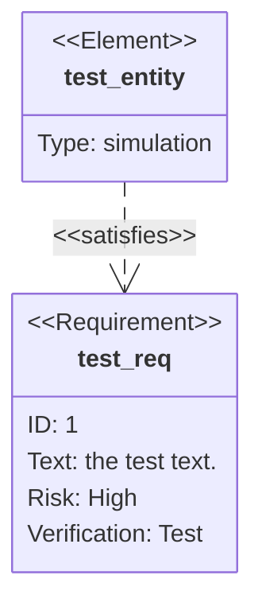

## C4

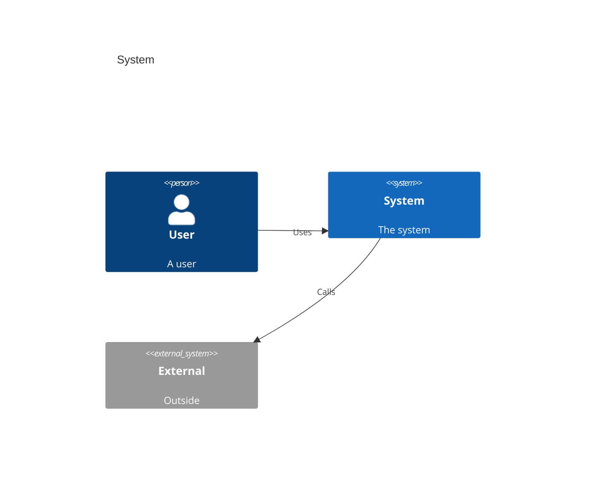

## Sankey

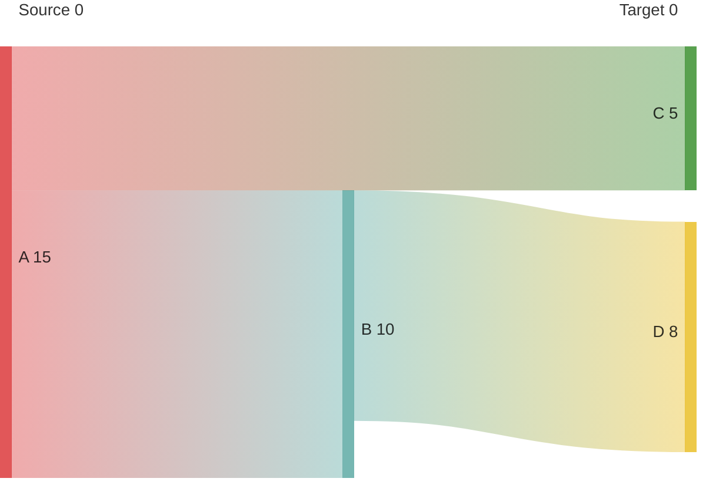

## XY chart

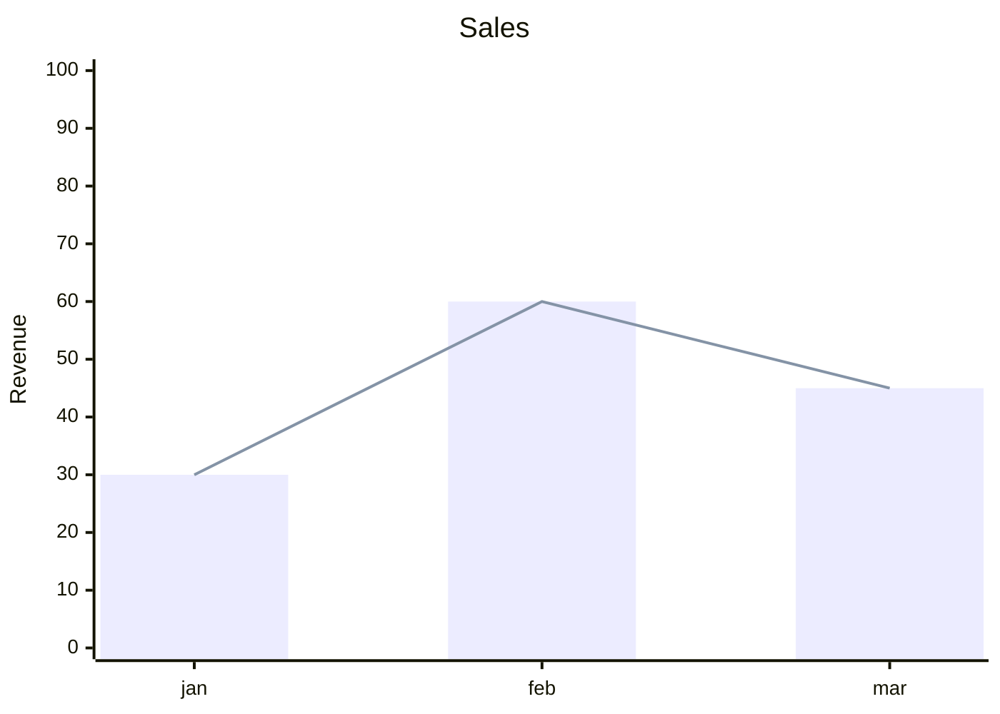

## Block

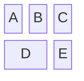

## Packet

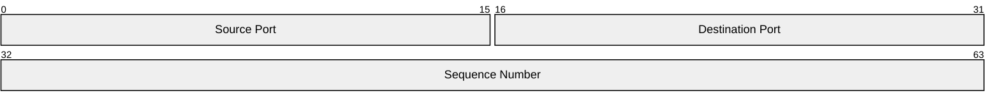

## Kanban

```mermaid
kanban
  Todo
    t1[Create task]
    t2[Review]
  Doing
    d1[Write code]
```

## Architecture

```mermaid
architecture-beta
  group api(cloud)[API]
  service db(database)[Database] in api
  service server(server)[Server] in api
  db:L -- R:server
```

## Radar

```mermaid
radar-beta
  axis a["A"], b["B"], c["C"]
  curve one["One"]{1, 2, 3}
  curve two["Two"]{3, 1, 2}
```

## Treemap

```mermaid
treemap-beta
"Root"
  "A": 10
  "B": 20
```

## Event modeling

```mermaid
eventmodeling

timeframe 01 ui CartUI
timeframe 02 command AddItem
timeframe 03 event ItemAdded

resetframe 04 event External.InventoryChanged
timeframe 05 processor InventoryProcessor
timeframe 06 command ChangeInventory
timeframe 07 event Cart.InventoryChanged
```

## Agent flow

```mermaid
agentflow-beta TB
  flow intake["Intake"]
    receive["Receive request"]@{ shape: input }
  end

  flow processing["Processing"]
    validate["Validate"]@{ shape: task }
    enrich["Enrich"]@{ shape: task }
    validate --> enrich
  end
  processing@{ view: "collapsed" }

  flow output["Output"]
    publish["Publish"]@{ shape: action }
  end

  receive --> validate
  enrich --> publish
```

## Cynefin

```mermaid
cynefin-beta
  title Strategy Categorization

  complex
    "Market research"

  complicated
    "Competitive analysis"

  clear
    "Standard pricing"

  chaotic
    "Crisis management"

  complex --> complicated : "Pattern identified"
  complicated --> clear : "Best practice codified"
  clear --> chaotic : "Complacency"
  chaotic --> complex : "Stabilized"
```

## Ishikawa

```mermaid
ishikawa-beta
    Blurry Photo
    Process
        Out of focus
        Shutter speed too slow
        Protective film not removed
        Beautification filter applied
    User
        Shaky hands
    Equipment
        LENS
            Inappropriate lens
            Damaged lens
            Dirty lens
        SENSOR
            Damaged sensor
            Dirty sensor
    Environment
        Subject moved too quickly
        Too dark
```

## Railroad

```mermaid
railroad-ebnf-beta
title "Arithmetic Expression Grammar"

expression = term ( ( "+" | "-" ) term )* ;
term = factor ( ( "*" | "/" ) factor )* ;
factor = number | "(" expression ")" ;
number = digit+ ;
digit = "0" | "1" | "2" | "3" | "4" | "5" | "6" | "7" | "8" | "9" ;
```

## Swimlane

```mermaid
swimlane-beta LR
  subgraph Applicant
    apply[Submit application]
    sign[Sign agreement]
  end

  subgraph Reviewer
    screen[Screen application]
    decide{Approved?}
  end

  subgraph System
    create[Create account]
    notify[Send welcome email]
  end

  apply -->|Application received| screen
  screen --> decide
  decide -->|Approved| create --> notify --> sign
  decide -->|Needs changes| apply
```

## Tree view

```mermaid
treeView-beta
    my-project/
        src/
            App.tsx ::highlight icon(logos:react) ## main component
            index.js ## entry point
        .env ## environment variables
        Dockerfile
        package.json
```

## Use case

```mermaid
usecase-beta
direction LR
actor Customer
actor Support
systemBoundary Storefront
  Browse("Browse catalog")
  Checkout("Checkout")
end
systemBoundary Fulfilment
  Track("Track delivery")
end
Customer --> Browse
Customer --> Checkout
Customer --> Track
Support --> Track
Checkout ..> : include Browse
```

## Venn

```mermaid
venn-beta
  set A["Frontend"]
    text A1["React"]
    text A2["Design Systems"]
  set B["Backend"]
    text B1["API"]
  union A,B["Shared"]
    text AB1["OpenAPI"]
```

## Wardley map

```mermaid
wardley-beta
title Sourcing Strategy

anchor Customer [0.80, 0.95]
component Custom App [0.45, 0.85] (build)
component Off-the-shelf Tool [0.85, 0.65] (buy)
component Managed Service [0.60, 0.40] (outsource)
component Cloud Platform [0.95, 0.25] (market)

Customer -> Custom App
Custom App -> Off-the-shelf Tool
Custom App -> Managed Service
Off-the-shelf Tool -> Cloud Platform
```

## Not a diagram

An image that must not change: ![[half-transparent.png]]
