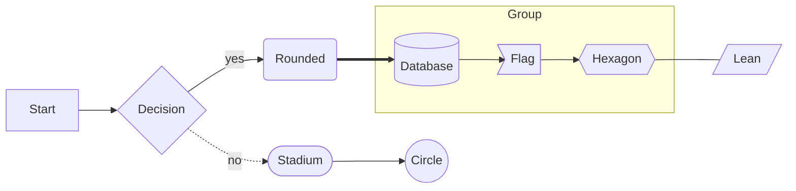
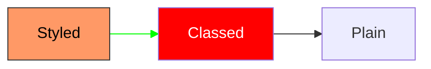
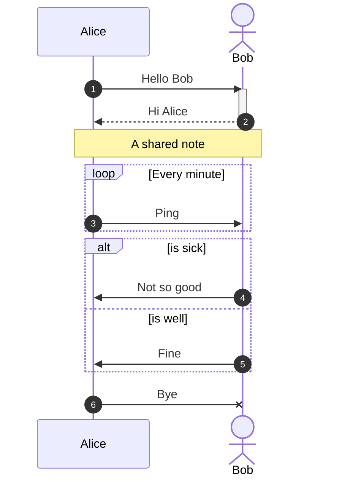
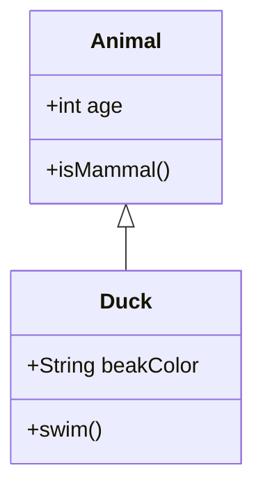
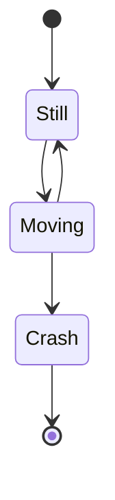
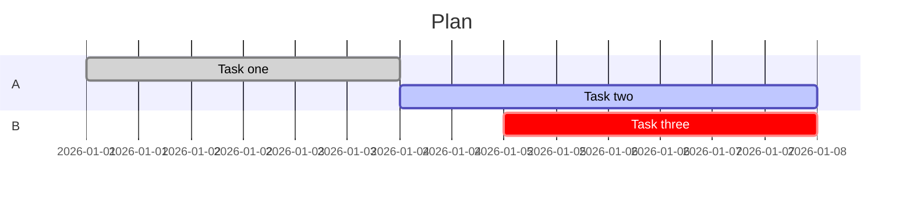
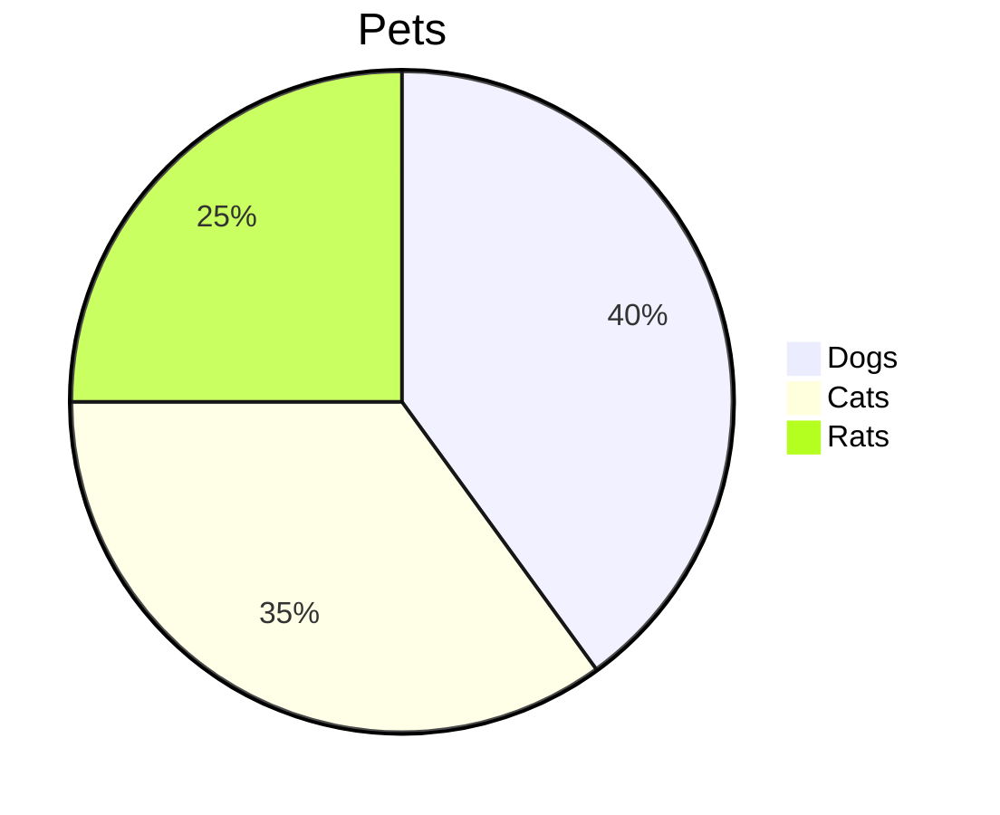
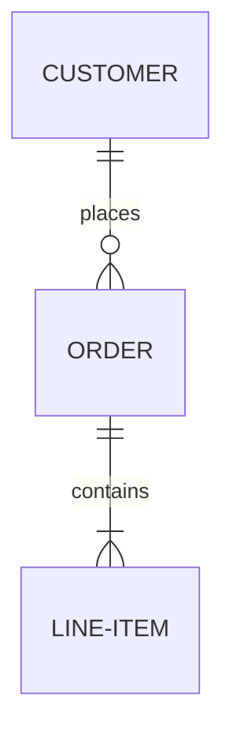
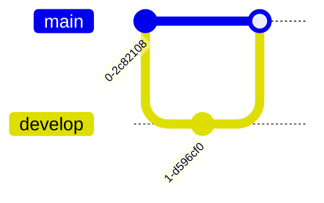
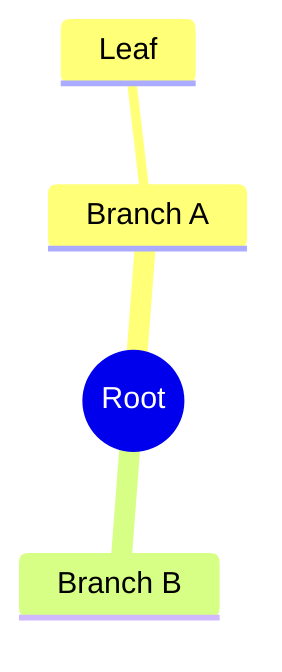

# Mermaid

## Flowchart

## Flowchart with user styles

## Sequence

## Class

## State

## Gantt

## Pie

## Entity relationship

## Git graph

## Mindmap

## Not a diagram

An image that must not change: ![[half-transparent.png]]
