# Mermaid

## Flowchart

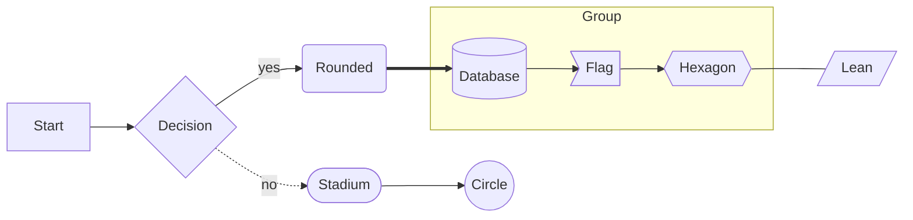

## Flowchart with user styles

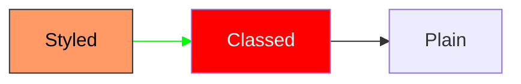

## Flowchart with SVG text labels

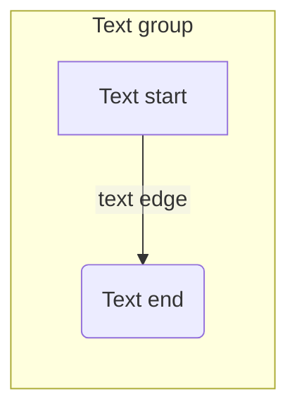

## Sequence

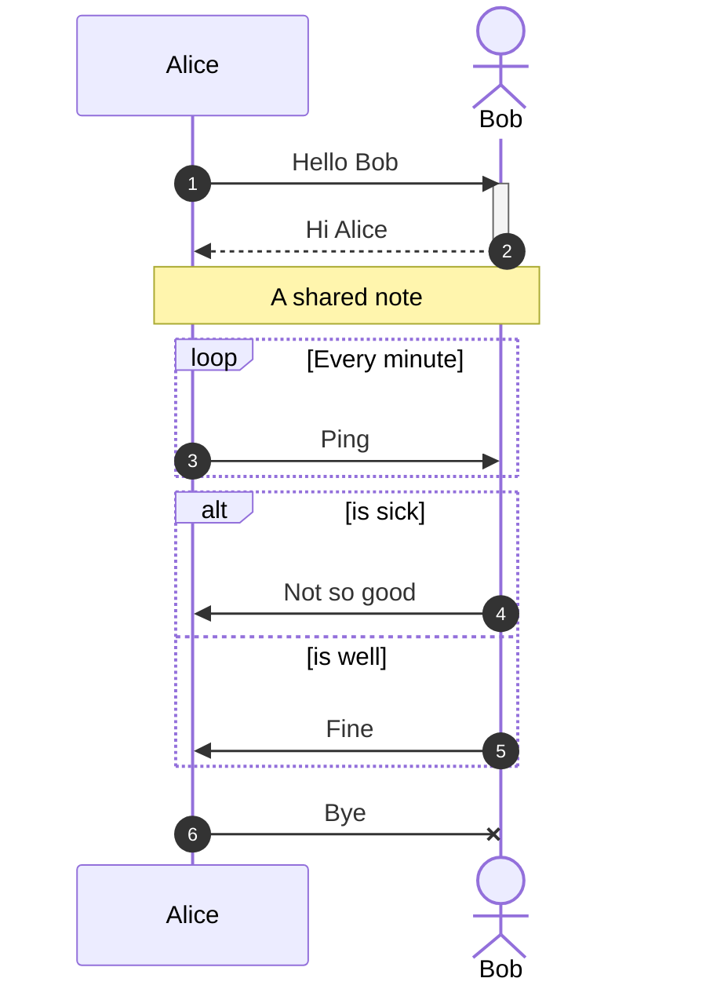

## Class

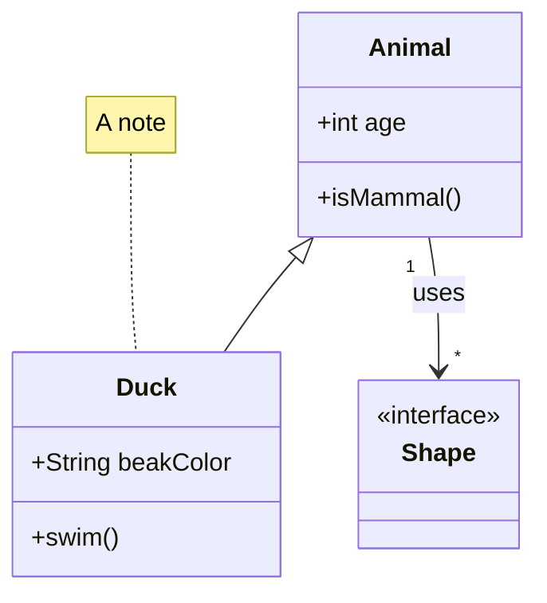

## State

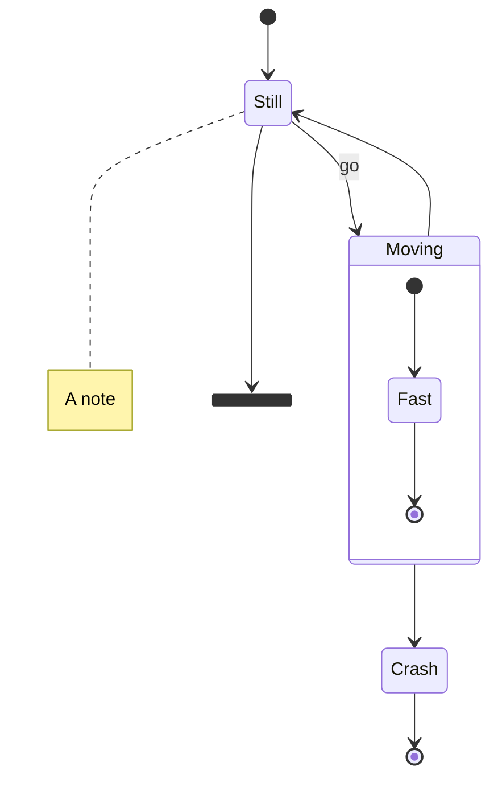

## Entity relationship

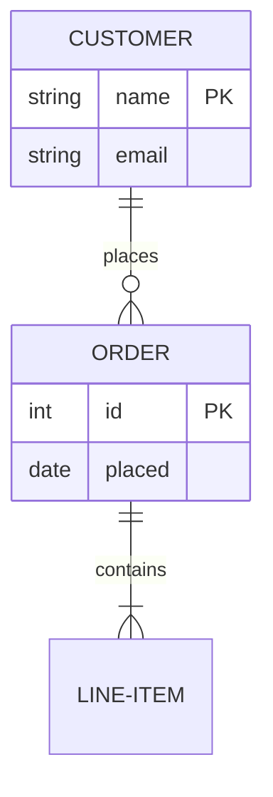

## Gantt

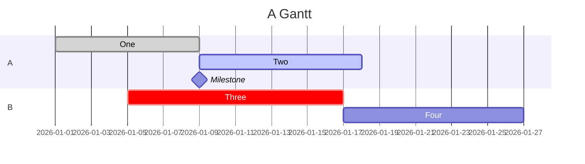

## Pie

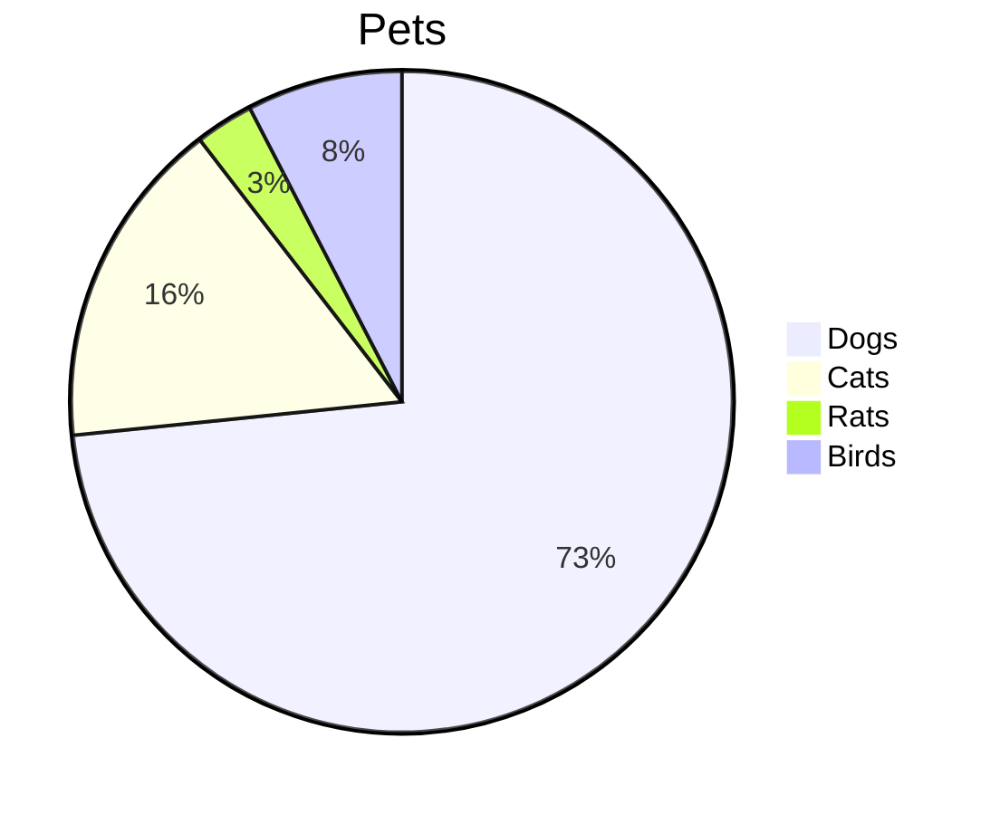

## User journey

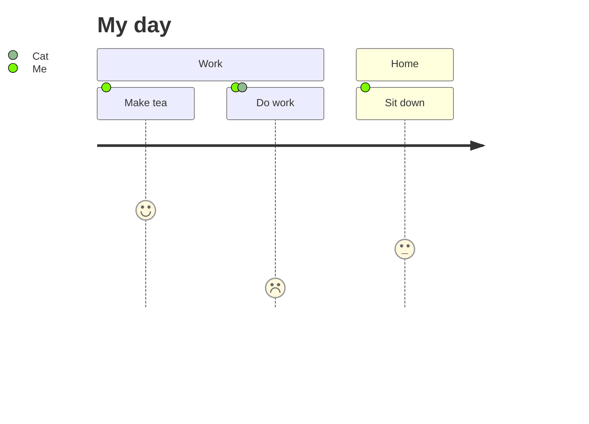

## Git graph

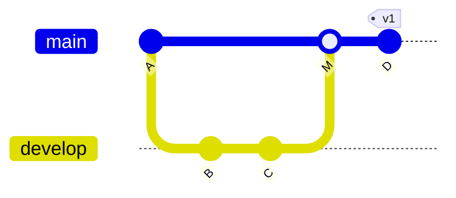

## Mindmap

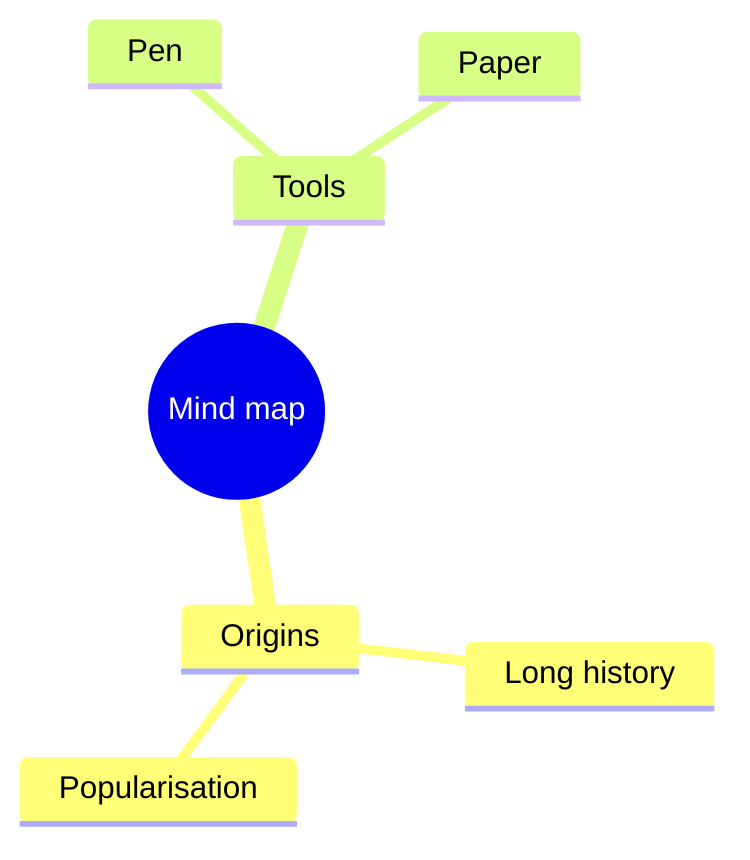

## Timeline

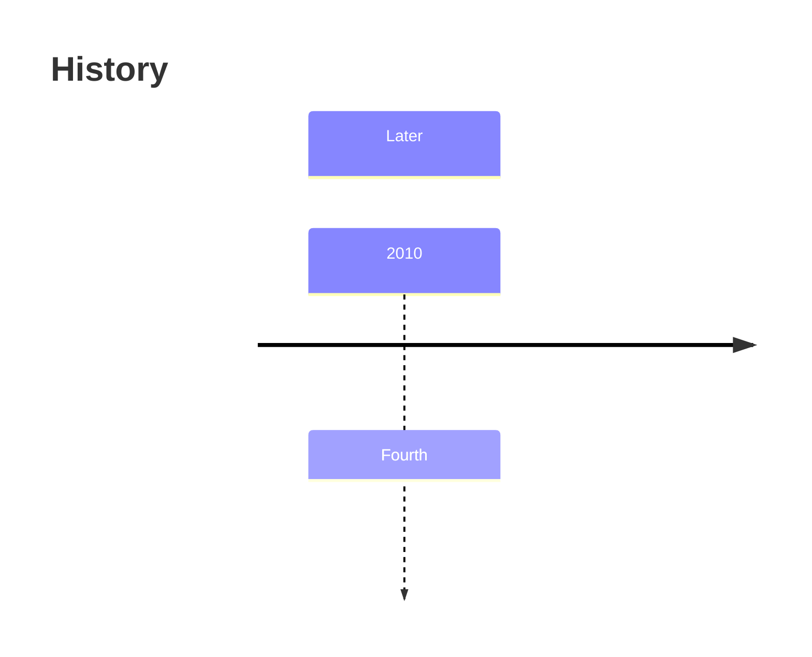

## Quadrant chart

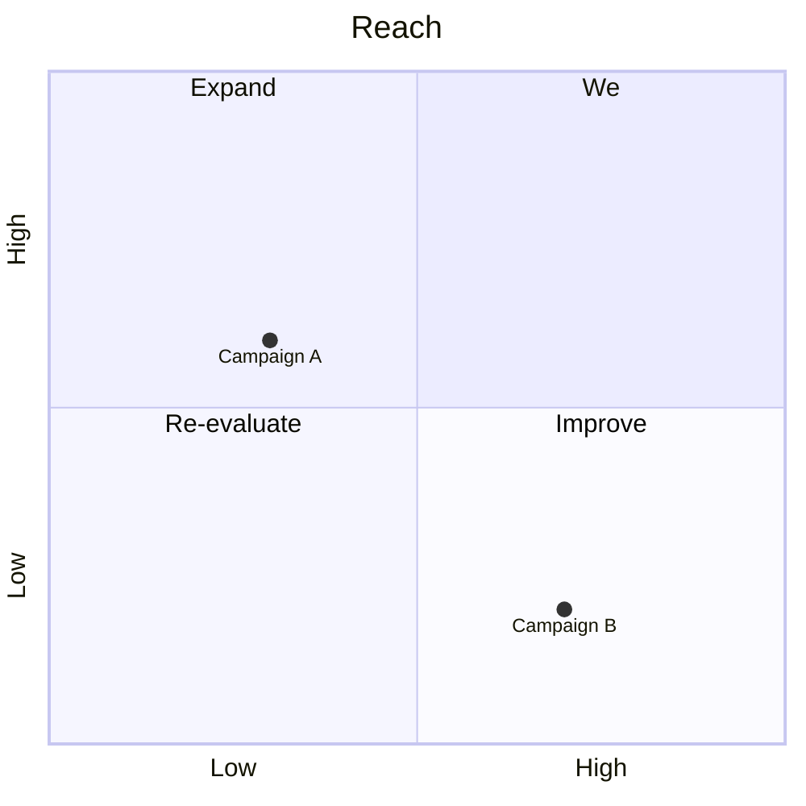

## Requirement

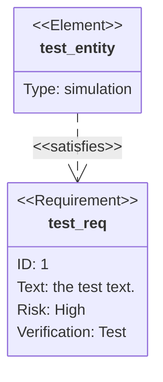

## C4

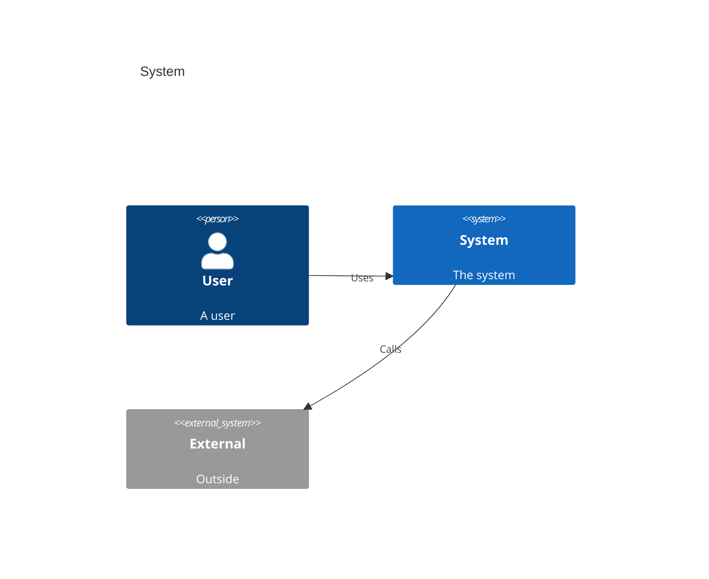

## Sankey

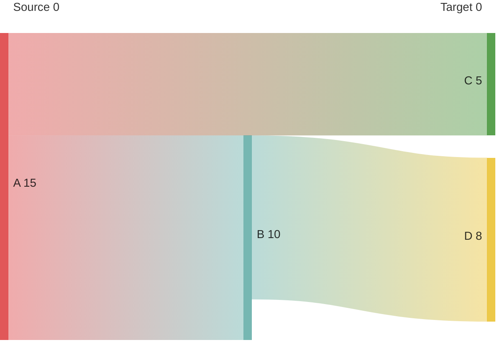

## XY chart

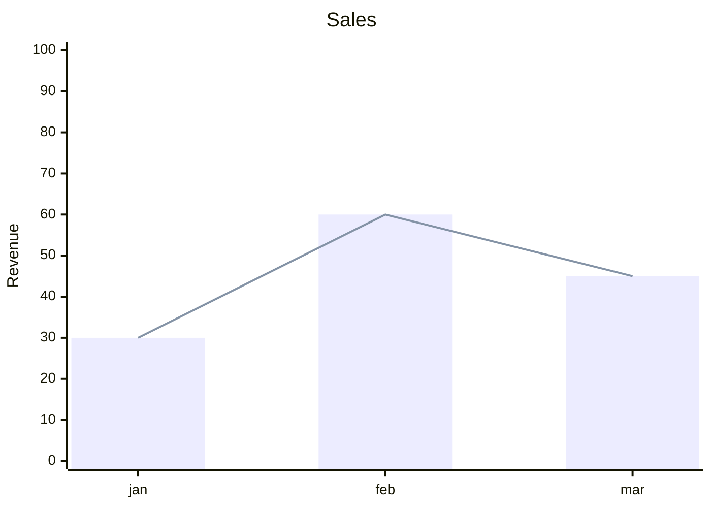

## Block

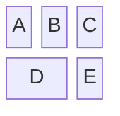

## Packet

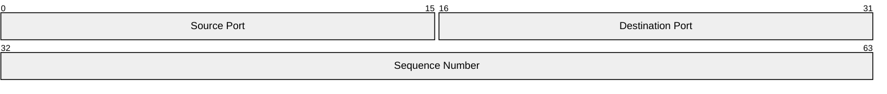

## Kanban

```mermaid
kanban
  Todo
    t1[Create task]
    t2[Review]
  Doing
    d1[Write code]
```

## Architecture

```mermaid
architecture-beta
  group api(cloud)[API]
  service db(database)[Database] in api
  service server(server)[Server] in api
  db:L -- R:server
```

## Radar

```mermaid
radar-beta
  axis a["A"], b["B"], c["C"]
  curve one["One"]{1, 2, 3}
  curve two["Two"]{3, 1, 2}
```

## Treemap

```mermaid
treemap-beta
"Root"
  "A": 10
  "B": 20
```

## Not a diagram

An image that must not change: ![[half-transparent.png]]
